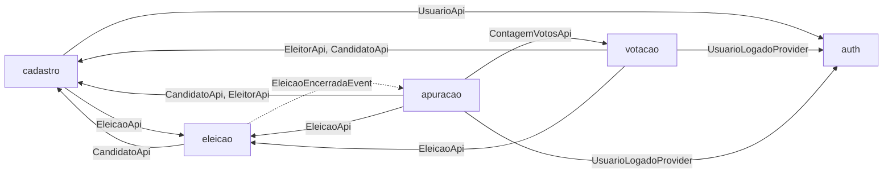
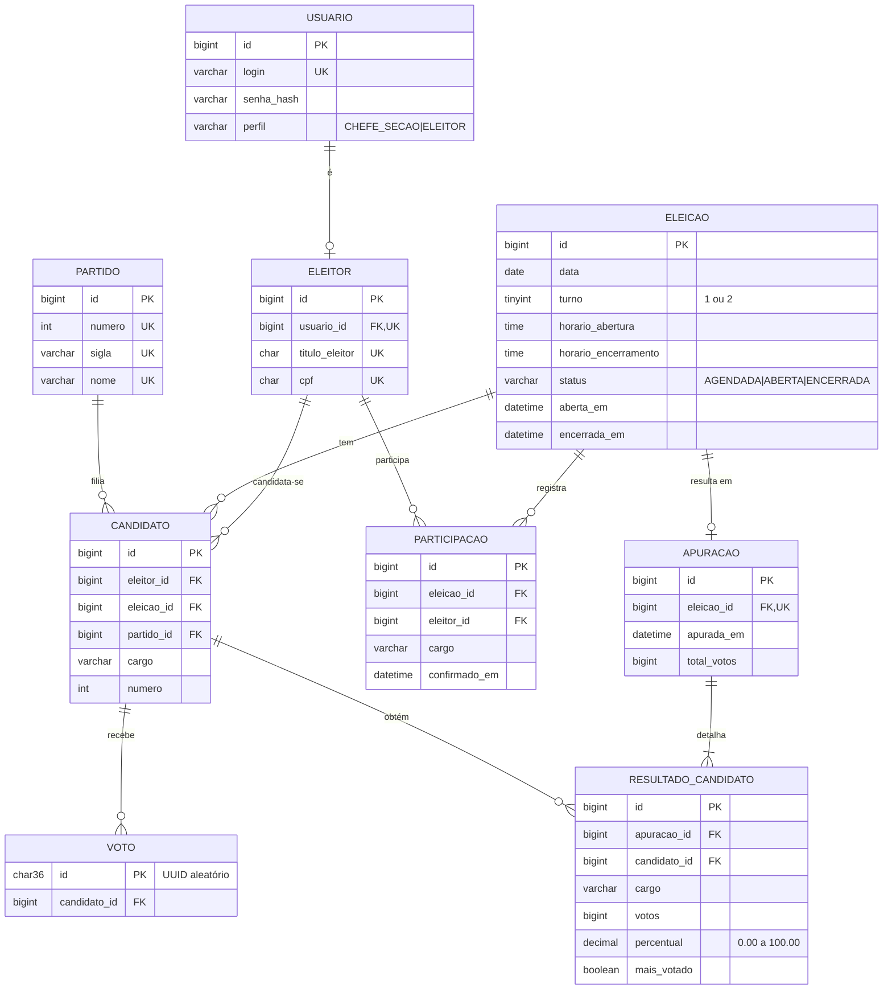

# Sistema de Simulação de Eleição Eletrônica (Back-End)

API REST que simula uma eleição eletrônica: administração da eleição pelo Chefe da Seção, cadastro de
eleitores e candidatos, votação com **sigilo do voto**, acompanhamento em tempo real e resultado final.

**Stack:** Java 17 · Spring Boot 3.3 · Spring Data JPA/Hibernate · Spring Security + JWT · MySQL 8 · Flyway ·
springdoc (Swagger UI) · JUnit 5 · Mockito · Testcontainers.

## Sumário

1. [Visão geral](#1-visão-geral)
2. [Arquitetura](#2-arquitetura)
3. [Modularização](#3-modularização)
4. [Modelagem do banco de dados](#4-modelagem-do-banco-de-dados)
5. [Endpoints e perfis](#5-endpoints-e-perfis)
6. [Testes](#6-testes)
7. [Documentação da API (Swagger)](#7-documentação-da-api-swagger)
8. [Como executar](#8-como-executar)
9. [Versionamento (Git)](#9-versionamento-git)
10. [Equipe](#10-equipe)

---

## 1. Visão geral

### Perfis de usuário

O sistema contempla três papéis de usuário: Chefe da Seção, Eleitor e Candidato. No banco e na API existem
**dois perfis**: `CHEFE_SECAO` e `ELEITOR`. O **candidato é um eleitor com uma candidatura** (como na vida
real, onde candidatos também votam). A restrição "o candidato só acompanha o próprio cargo" é decidida pelos
dados (existe candidatura dele na eleição?), e não por um terceiro perfil.

| Quem | Pode |
|---|---|
| **Chefe da Seção** | Cadastrar, alterar, consultar e excluir eleitores e candidatos; cadastrar eleição; abrir e encerrar a votação; consultar a situação da eleição |
| **Eleitor** | Consultar candidatos; votar (uma vez por cargo); acompanhar a votação de todos os cargos; ver o resultado final |
| **Eleitor que é candidato** | Tudo o que o eleitor faz, mas **acompanha apenas o cargo** para o qual concorre |

### Ciclo da eleição

`AGENDADA` → `ABERTA` → `ENCERRADA`. Somente o Chefe abre e encerra. Só se vota com a eleição `ABERTA`; só se
cadastra, altera ou exclui candidato com a eleição `AGENDADA`. Depois de confirmado, o voto não pode ser alterado.

---

## 2. Arquitetura

O projeto é um **monólito modular em camadas**: uma única aplicação Spring Boot, dividida em módulos de
negócio isolados. Cada módulo segue a mesma estrutura interna.

```
Requisição HTTP
   │
   ▼
Filtro JWT + regras de acesso (módulo auth)       → 401 / 403
   │
   ▼
Controller   recebe e valida o JSON (DTO), devolve o status HTTP. Sem regra de negócio.
   │
   ▼
Service      regras de negócio e transações (@Transactional)
   │
   ▼
Repository   acesso ao banco (Spring Data JPA)
   │
   ▼
MySQL        constraints (UNIQUE, FK, CHECK) como última barreira
```

### Princípios adotados

- **Regra de negócio só no service.** O controller só traduz HTTP; o repository só acessa dados.
- **DTOs na API, entidades no domínio.** Entidades nunca saem em respostas HTTP (evita vazar CPF e hash de senha e
  desacopla a API do banco).
- **Módulos conversam por interfaces (`api/`)**, nunca pelo repository ou service de outro módulo. É o
  *Princípio da Inversão de Dependência (SOLID)*: quem usa depende de uma abstração. Por isso um módulo pode ser
  testado com mocks sem o outro existir.
- **O banco também protege as regras:** duplicidade de voto, número de candidato e demais unicidades têm
  `UNIQUE`/`FK`/`CHECK`, como trava final contra requisições simultâneas.
- **Schema versionado com Flyway:** o banco só muda por novas migrations. **Nunca se edita uma migration já
  commitada** (o Flyway guarda o checksum e recusa a aplicação).
- **API stateless:** autenticação por token JWT no cabeçalho `Authorization: Bearer <token>`, sem sessão no servidor.

### Tratamento de erros

Um `GlobalExceptionHandler` converte as exceções de domínio em respostas JSON padronizadas
(`timestamp`, `status`, `erro`, `mensagem`, `caminho`, `detalhes`):

| Status | Quando | Exceção |
|---|---|---|
| 400 | Dados inválidos (validação, JSON malformado, enum inexistente) | `MethodArgumentNotValidException` etc. |
| 401 | Sem token, token inválido/expirado ou credenciais erradas | tratado no módulo auth |
| 403 | Perfil sem permissão para a rota | tratado no módulo auth |
| 404 | Recurso não encontrado | `NotFoundException` |
| 409 | Conflito (duplicidade, vínculo que impede a exclusão) | `ConflictException` |
| 422 | Regra de negócio violada (eleição não está no estado exigido etc.) | `BusinessRuleException` |
| 403 | Regra que depende dos dados (candidato tentando acompanhar outro cargo) | `ForbiddenException` |
| 400 | Valor inválido na URL (ex.: `?cargo=PREFEITO`, `?status=PAUSADA`) | `MethodArgumentTypeMismatchException` |

---

## 3. Modularização

```
src/main/java/com/eleicao
├── EleicaoApplication.java
├── shared/        código comum: enums (Cargo, Perfil, StatusEleicao) e exceções
├── auth/          login, JWT, segurança, UsuarioApi
├── cadastro/      eleitores, candidatos, partidos
├── eleicao/       eleição e seu ciclo de vida
├── votacao/       voto e participação
└── apuracao/      acompanhamento e resultado
```

Dentro de cada módulo:

```
modulo/
├── api/          interfaces públicas: a ÚNICA parte que outros módulos podem usar
├── controller/   endpoints REST
├── service/      regras de negócio
├── repository/   acesso a dados
├── domain/       entidades JPA
└── dto/          objetos de entrada e saída da API
```

### O que cada módulo oferece aos demais (`api/`)

| Módulo | Interface | Usada para |
|---|---|---|
| `auth` | `UsuarioApi` | criar, atualizar e remover o login de um usuário (usado pelo cadastro) |
| `auth` | `UsuarioLogadoProvider` | saber quem está fazendo a requisição (`usuarioId`, perfil) |
| `cadastro` | `EleitorApi` | buscar eleitor por id ou pelo usuário logado |
| `cadastro` | `CandidatoApi` | buscar/listar candidatos; saber se um eleitor é candidato em uma eleição |
| `eleicao` | `EleicaoApi` | buscar eleição; exigir que esteja `AGENDADA` ou `ABERTA` |
| `eleicao` | `EleicaoEncerradaEvent` | avisar que a votação foi encerrada (a apuração grava o resultado final) |
| `votacao` | `ContagemVotosApi` | contar votos por candidato em um cargo (usado pela apuração) |

### Dependências entre módulos



A seta tracejada é um **evento** (`EleicaoEncerradaEvent`): ao encerrar a votação, o módulo `eleicao` só publica o
evento e o módulo `apuracao` escuta e grava o resultado final. Assim o `eleicao` não depende do `apuracao`.

### Exemplo concreto: cadastrar um eleitor

1. `EleitorController` recebe o `EleitorRequest` e valida os campos.
2. `EleitorService` verifica se título e CPF estão livres.
3. Chama `UsuarioApi.criar(...)` (módulo `auth`) para criar o login com senha em BCrypt.
4. Grava o `Eleitor` na **mesma transação**: se um passo falhar, nada é gravado.
5. Devolve um `EleitorResponse` (sem senha).

---

## 4. Modelagem do banco de dados

SGBD: MySQL 8.0.16 ou superior (necessário para as restrições `CHECK`); os testes de integração usam MySQL 8.4.
O schema fica em `src/main/resources/db/migration` (V1 schema, V2 dados iniciais, V3 partidos, V4 apuração).
Descrição completa em [docs/modelagem.md](docs/modelagem.md).



### Regras garantidas pelo próprio banco

| Regra de negócio | Como o banco garante |
|---|---|
| Um eleitor vota uma única vez por cargo, por eleição/turno | `UNIQUE (eleicao_id, eleitor_id, cargo)` em `participacao` |
| Não existem duas eleições no mesmo dia e turno | `UNIQUE (data, turno)` em `eleicao` |
| Turno só pode ser 1 ou 2; encerramento depois da abertura; status válido | `CHECK` em `eleicao` |
| Número do candidato único por cargo na eleição | `UNIQUE (eleicao_id, cargo, numero)` em `candidato` |
| Uma pessoa concorre a um único cargo por eleição | `UNIQUE (eleitor_id, eleicao_id)` em `candidato` |
| Só quem é eleitor pode ser candidato | `FK candidato.eleitor_id → eleitor.id` |
| CPF, título, login e número/sigla do partido únicos | `UNIQUE` nas respectivas tabelas |
| Cargos válidos | `CHECK` em `candidato.cargo` e `participacao.cargo` |
| Uma eleição tem um único resultado final | `UNIQUE (eleicao_id)` em `apuracao` |
| Um candidato aparece uma vez no resultado | `UNIQUE (apuracao_id, candidato_id)` em `resultado_candidato` |

### Sigilo do voto

O voto é gravado em **dois registros separados, na mesma transação**:

- `participacao` responde "o eleitor X já votou para Governador?" (impede duplicidade) e **não sabe em quem**.
- `voto` responde "quantos votos o candidato Y teve?" e **não sabe quem votou**.

Para que não seja possível reconstruir a ligação por vias indiretas: `voto` não tem `eleitor_id`, **não tem
data/hora** (senão cruzaria com `participacao.confirmado_em`) e seu `id` é um **UUID aleatório** (um
auto-incremento permitiria cruzar a ordem com `participacao.id`).

### Outras decisões de modelagem

- **Candidato é um eleitor com candidatura** (`candidato.eleitor_id`): não há perfil `CANDIDATO`.
- **Partidos reais do TSE** (30) carregados pela migration V3, com número da legenda. Regra de negócio no serviço:
  o **número do candidato começa com o número do partido** (partido 13 → candidatos 13, 131, 13456…).
- `eleicao.aberta_em` / `encerrada_em` guardam quando o Chefe **de fato** abriu/encerrou, diferente do horário agendado.
- **Apuração parcial não é gravada** (é calculada a cada consulta a partir de `voto`); o **resultado final é gravado
  uma única vez** no encerramento (`apuracao` + `resultado_candidato`), ficando congelado como registro oficial.

---

## 5. Endpoints e perfis

A restrição por perfil fica concentrada em `RegrasDeAcesso` (módulo `auth`); vale a primeira regra que casar.

| Rota | Método | Quem pode |
|---|---|---|
| `/auth/login` | POST | público |
| `/swagger-ui.html`, `/v3/api-docs/**` | todos | público |
| `/auth/me` | GET | qualquer usuário logado |
| `/eleitores/**` | todos | Chefe da Seção |
| `/candidatos/**`, `/partidos/**` | GET | qualquer usuário logado |
| `/candidatos/**` | POST, PUT, DELETE | Chefe da Seção |
| `/eleicoes/**`, `/apuracao/**` | GET | qualquer usuário logado |
| `/eleicoes/**`, `/apuracao/**` | demais métodos | Chefe da Seção |
| `/votacao/**` | todos | Eleitor |

### Resumo dos endpoints

| Módulo | Endpoints | Detalhes |
|---|---|---|
| `auth` | `POST /auth/login`, `GET /auth/me` | [docs/auth.md](docs/auth.md) |
| `cadastro` | `/eleitores`, `/candidatos`, `/partidos` | [docs/modulo-cadastro.md](docs/modulo-cadastro.md) |
| `eleicao` | `/eleicoes` (CRUD), `GET /eleicoes/{id}/situacao`, `POST /eleicoes/{id}/abertura`, `POST /eleicoes/{id}/encerramento` | [docs/modulo-eleicao.md](docs/modulo-eleicao.md) |
| `votacao` | `GET /votacao/eleicoes/{id}/cargos/{cargo}/candidatos`, `POST /votacao/eleicoes/{id}/voto/registro`, `POST /votacao/eleicoes/{id}/voto/confirmacao` | [docs/modulo-votacao.md](docs/modulo-votacao.md) |
| `apuracao` | `GET /apuracao/eleicoes/{id}/parcial`, `GET /apuracao/eleicoes/{id}/resultado` (ambos com `?cargo=` opcional) | [docs/modulo-eleicao.md](docs/modulo-eleicao.md) |

---

## 6. Testes

| | Teste unitário | Teste de integração |
|---|---|---|
| Nome da classe | `*Test` | `*IT` |
| Plugin / comando | surefire · `mvn test` | failsafe · `mvn verify` |
| O que sobe | só a classe testada | Spring completo + **MySQL real em container** (Testcontainers) |
| Dependências | mocks (Mockito) | reais (banco, segurança, JSON) |
| O que prova | a **regra de negócio** do service | as camadas funcionando juntas: HTTP → service → banco, com JWT |
| Precisa de Docker | não | **sim** |

Exemplo: no unitário, um mock *diz* "este CPF já existe". No de integração, o MySQL **realmente recusa** o CPF
repetido, o `DELETE` barrado por uma chave estrangeira etc.

Todas as classes `*IT` herdam de `AbstractIntegrationTest`, que sobe **um** MySQL por execução, aplica as
migrations do Flyway nele e aponta o Spring para esse banco. Cada teste roda numa transação que é desfeita no final.

### Classes de teste

| Módulo | Unitários | Integração |
|---|---|---|
| `auth` | `JwtServiceTest` (8), `RegrasDeAcessoTest` (13), `AuthServiceTest` (4), `UsuarioServiceTest` (8), `SecurityContextUsuarioLogadoProviderTest` (2) | `AuthIT` (3) |
| `cadastro` | `EleitorServiceTest` (14), `CandidatoServiceTest` (24 métodos, 31 execuções), `PartidoServiceTest` (3) | `CadastroIT` (12) |
| banco (schema) | n/a | `SchemaIntegridadeIT` (5), `EleicaoApplicationIT` (1) |
| `eleicao` | `EleicaoServiceTest` (20 métodos, 24 execuções), `EleicaoApiImplTest` (3) | `EleicaoApuracaoIT` (4, cobre também `apuracao` e a integração com `cadastro` e `votacao`) |
| `votacao` | `VotacaoServiceTest` (8), `ContagemVotosServiceTest` (2) | coberto pelo fluxo completo de `EleicaoApuracaoIT` |
| `apuracao` | `ApuracaoServiceTest` (10 métodos, 11 execuções), `CalculoApuracaoTest` (4) | `EleicaoApuracaoIT` |

### Como rodar

- **Unitários:** `mvn test`, ou no IntelliJ botão direito em `src/test/java` > *Run 'All Tests'*.
- **Integração:** abra o **Docker Desktop** (espere *Engine running*) e rode `mvn verify`, ou use o ▶ da classe `*IT`.
- Com Docker Desktop recente (Engine 29), o arquivo `src/test/resources/docker-java.properties` (`api.version=1.44`)
  é necessário para o Testcontainers conversar com o Docker.

---

## 7. Documentação da API (Swagger)

A documentação é **gerada automaticamente** pelo springdoc a partir dos controllers e dos DTOs
(`@Tag`, `@Operation` e as anotações de validação).

- **Swagger UI:** `http://localhost:8080/swagger-ui.html`
- **OpenAPI (JSON):** `http://localhost:8080/v3/api-docs`

Para testar rotas protegidas: faça `POST /auth/login` (por exemplo, `chefe` / `admin123`), copie o `token`, clique em
**Authorize** (cadeado) e cole o token. Ele vale 2 horas.

O contrato completo também fica versionado no repositório em [`docs/openapi.json`](docs/openapi.json), que pode
ser aberto em qualquer visualizador OpenAPI (ex.: colando o conteúdo em https://editor.swagger.io).

Para atualizar o arquivo depois de mudar algum endpoint: suba a aplicação, abra `http://localhost:8080/v3/api-docs`
e salve o conteúdo em `docs/openapi.json`.

---

## 8. Como executar

### Requisitos

- JDK 17 ou superior (testado com JDK 24)
- Maven (ou o Maven embutido no IntelliJ)
- MySQL 8.0.16+ **ou** Docker (para o `docker compose`)
- Docker Desktop, apenas para os testes de integração

### 1. Banco de dados

Opção A, MySQL instalado na máquina (rode como `root`, no MySQL Workbench ou no terminal):

```sql
CREATE DATABASE IF NOT EXISTS eleicao;
CREATE USER IF NOT EXISTS 'eleicao'@'localhost' IDENTIFIED BY 'eleicao';
GRANT ALL PRIVILEGES ON eleicao.* TO 'eleicao'@'localhost';
FLUSH PRIVILEGES;
```

Opção B, MySQL em container: `docker compose up -d` (usa o `docker-compose.yml` da raiz: banco e usuário `eleicao`).

As tabelas e os dados iniciais são criados pelo Flyway na primeira execução.

### 2. Subir a aplicação

```
mvn spring-boot:run
```

No IntelliJ: abra `EleicaoApplication` e clique no ▶. API em `http://localhost:8080`.

Não é preciso nenhum perfil especial: o antigo perfil `stub` (`cadastro/dev`) foi removido quando o módulo
`eleicao` real foi integrado. Se a sua configuração de execução ainda tiver `-Dspring.profiles.active=stub`, ela
continua funcionando (o perfil simplesmente não ativa mais nada), mas pode ser apagada.

### Roteiro de demonstração (Swagger, Postman ou Insomnia)

1. `POST /auth/login` como `chefe` / `admin123`.
2. `POST /eleicoes` → `{"data": "2026-12-06", "turno": 1, "horarioAbertura": "08:00:00", "horarioEncerramento": "17:00:00"}`.
3. `POST /eleitores` (pelo menos 3) e `POST /candidatos` (pelo menos 2, ex.: dois para `GOVERNADOR`).
4. `POST /eleicoes/{id}/abertura` → status `ABERTA`.
5. Login de cada eleitor → `POST /votacao/eleicoes/{id}/voto/registro` e depois `.../voto/confirmacao`.
6. `GET /apuracao/eleicoes/{id}/parcial` (como eleitor comum: todos os cargos; como candidato: só o cargo dele).
7. `POST /eleicoes/{id}/encerramento` (como Chefe) → status `ENCERRADA`; o resultado final é gravado.
8. `GET /apuracao/eleicoes/{id}/resultado` → votos, percentuais e mais votado de cada cargo.

### Configuração (variáveis de ambiente)

| Variável | Padrão | Uso |
|---|---|---|
| `DB_URL` | `jdbc:mysql://localhost:3306/eleicao?serverTimezone=America/Sao_Paulo` | URL do banco |
| `DB_USER` / `DB_PASSWORD` | `eleicao` / `eleicao` | credenciais do banco |
| `JWT_SECRET` | valor de desenvolvimento | segredo do JWT (mínimo 32 caracteres; defina em produção) |
| `JWT_EXPIRACAO` | `2h` | validade do token |

### Usuário inicial

A migration V2 cria o Chefe da Seção: login `chefe`, senha `admin123` (guardada com BCrypt).

### Solução de problemas

| Sintoma | Causa e solução |
|---|---|
| `Access denied for user 'eleicao'` com a senha certa | Uma variável de ambiente `DB_PASSWORD` (ou `DB_USER`) definida no sistema tem prioridade sobre o valor padrão do `application.yml`. Ela deve ser removida ou sobrescrita na configuração de execução. |
| `Migration checksum mismatch` | Uma migration já aplicada no banco foi alterada. O banco local deve ser recriado (`DROP DATABASE eleicao; CREATE DATABASE eleicao;`, seguido do `GRANT`). |
| Erros de `Lombok` / `TypeTag :: UNKNOWN` no build | Incompatibilidade entre JDK recente e versão antiga do Lombok. O `pom.xml` fixa `lombok.version` em 1.18.38 e declara o processador de anotações; basta recarregar o Maven. |
| `Could not find a valid Docker environment` nos `*IT` | Docker Desktop fechado, ou Engine 29 sem o `docker-java.properties` (seção 6). |

---

## 9. Versionamento (Git)

- Cada módulo ou funcionalidade é desenvolvido em uma **branch própria** (`feature/auth`, `feature/cadastro`...),
  criada a partir da `main` e integrada por **Pull Request**.
- As mensagens de commit seguem o padrão **Conventional Commits**: `feat(cadastro): ...`, `test(cadastro): ...`,
  `docs(auth): ...`, `build: ...`, `fix: ...`.
- Migrations já commitadas não são editadas; mudanças de banco entram como uma nova versão (`V4`, `V5`...).

## 10. Equipe

| Módulo | Responsável |
|---|---|
| `auth` | *Guilherme Silva Leal* |
| `eleicao` e `apuracao` | *Breno Freitas* |
| `cadastro` | *Gabriel Rocha* |
| `votacao` | *Luis Felipe Coelho* |
