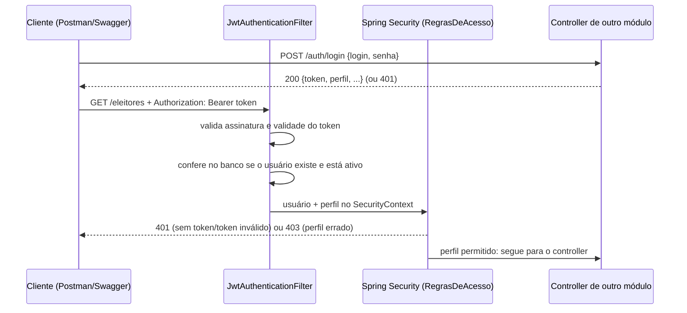

# Módulo `auth` — Autenticação e autorização

Responsável: Pessoa A. Pacote: `com.eleicao.auth`.

Este módulo responde duas perguntas em toda requisição:

1. **Quem é você?** (autenticação): login com usuário e senha, que devolve um token JWT.
2. **Você pode fazer isso?** (autorização): regras de acesso por perfil (`CHEFE_SECAO` ou `ELEITOR`).

## Arquitetura

A API é **stateless**: o servidor não guarda sessão. No login, o cliente recebe um token JWT
assinado e o envia em todas as requisições seguintes no cabeçalho
`Authorization: Bearer <token>`.



### Decisões e por quê

| Decisão | Motivo |
|---|---|
| JWT assinado com HMAC-SHA256 (biblioteca jjwt) | O servidor não precisa guardar sessão. Quem altera o token (ex.: troca `ELEITOR` por `CHEFE_SECAO`) invalida a assinatura. |
| Token carrega só `sub` (id do usuário) e `perfil` | O JWT é assinado, **não criptografado**: qualquer um lê o conteúdo. Nada sigiloso vai nele. |
| Validade de 2h (`app.jwt.expiracao`) | Limita o estrago se um token vazar. |
| Segredo em `JWT_SECRET` (mínimo 32 bytes) | O segredo não fica no código em produção. A aplicação nem sobe com um segredo curto. |
| Senhas com BCrypt (custo 10) | Hash lento e com *salt*: mesmo com o banco vazado, as senhas não são recuperáveis facilmente. |
| Filtro confere o usuário no banco a cada requisição | Um eleitor excluído (ou inativo) perde o acesso na hora, mesmo com token ainda dentro da validade. |
| Mesma mensagem para "login não existe" e "senha errada" | Não revela quais logins existem. O login inexistente também roda um BCrypt fictício para levar o mesmo tempo. |
| CSRF desligado | CSRF explora cookies de sessão enviados automaticamente pelo navegador. Aqui não há cookie: o token vai num cabeçalho. |
| 401 × 403 | **401**: não sei quem você é (sem token, token inválido/expirado). **403**: sei quem você é, mas seu perfil não pode. |

## Modularização

```
com.eleicao.auth
├── api/                  ← contrato público: a ÚNICA parte que outros módulos usam
│   ├── UsuarioApi                criar/atualizar/remover login (usado pelo cadastro)
│   ├── UsuarioLogadoProvider     "quem está fazendo esta requisição?" (votação, apuração)
│   └── UsuarioLogado             (usuarioId, perfil)
├── domain/Usuario        ← entidade JPA da tabela usuario
├── repository/           ← UsuarioRepository (só o auth acessa a tabela)
├── service/
│   ├── UsuarioService            implementação da UsuarioApi (gera o hash BCrypt)
│   └── AuthService               caso de uso do login
├── security/
│   ├── SecurityConfig            configuração do Spring Security
│   ├── RegrasDeAcesso            tabela "perfil × rota" (num lugar só)
│   ├── JwtService                gera e valida tokens
│   ├── JwtAuthenticationFilter   lê o token em cada requisição
│   ├── RespostasDeErroDeSeguranca  401/403 em JSON (mesmo formato ErrorResponse)
│   └── SecurityContextUsuarioLogadoProvider  implementação do UsuarioLogadoProvider
├── controller/AuthController     POST /auth/login, GET /auth/me
├── dto/                  ← LoginRequest, TokenResponse, UsuarioResponse
├── exception/            ← CredenciaisInvalidasException, AuthExceptionHandler
└── config/OpenApiConfig  ← botão "Authorize" (Bearer) no Swagger UI
```

**Como os outros módulos usam o auth** (sempre pelas interfaces de `auth.api`, nunca pelas classes internas):

- **cadastro**: `usuarioApi.criar(nome, login, senha, Perfil.ELEITOR)` ao cadastrar eleitor.
  A senha chega em texto puro e só o auth gera o hash.
- **votação / apuração**: `usuarioLogadoProvider.atual()` devolve `(usuarioId, perfil)`.
  Com o `usuarioId`, `EleitorApi.buscarPorUsuario` encontra o eleitor, e
  `CandidatoApi.buscarPorEleitorEEleicao` diz se ele é candidato (para restringir a apuração ao cargo dele).

Nenhum outro módulo importa nada de Spring Security ou JWT. Se um dia a autenticação mudar
(ex.: OAuth), só o pacote `auth` muda.

### Regras de acesso por rota

Definidas em `RegrasDeAcesso` (vale a primeira que casar, de cima para baixo):

| Rota | Método | Quem pode |
|---|---|---|
| `/auth/login` | POST | público |
| `/swagger-ui.html`, `/swagger-ui/**`, `/v3/api-docs/**` | todos | público |
| `/eleitores/**` | todos | Chefe da Seção |
| `/candidatos/**`, `/partidos/**` | GET | qualquer logado |
| `/candidatos/**`, `/partidos/**` | POST/PUT/DELETE | Chefe da Seção |
| `/eleicoes/**`, `/apuracao/**` | GET | qualquer logado |
| `/eleicoes/**`, `/apuracao/**` | POST/PUT/PATCH/DELETE | Chefe da Seção |
| `/votacao/**` | todos | Eleitor |
| qualquer outra | todos | qualquer logado |

A regra "o candidato só acompanha o próprio cargo" **não** está aqui: ela depende de dados
(a candidatura dele naquela eleição), então fica no serviço de apuração.

## Modelagem (tabela `usuario`)

| Coluna | Tipo | Regra |
|---|---|---|
| `id` | BIGINT PK | auto-incremento |
| `nome` | VARCHAR(120) | obrigatório |
| `login` | VARCHAR(60) | `UNIQUE` (`uk_usuario_login`) |
| `senha_hash` | VARCHAR(100) | hash BCrypt (60 caracteres), nunca a senha pura |
| `perfil` | VARCHAR(20) | `CHECK (perfil IN ('CHEFE_SECAO','ELEITOR'))` |
| `ativo` | BOOLEAN | usuário inativo não loga e tokens dele deixam de valer |
| `criado_em` | DATETIME | data de criação |

- `eleitor.usuario_id` → `usuario.id` (1:1, `UNIQUE`): todo eleitor tem um login.
- **Não existe perfil `CANDIDATO`**: o candidato é um eleitor com candidatura (veja `modelagem.md`).
- O primeiro Chefe da Seção é criado pela migration `V2__dados_iniciais.sql`
  (login `chefe`, senha `admin123`), senão ninguém conseguiria cadastrar os outros.

## Testes

| Classe | Tipo | O que garante |
|---|---|---|
| `JwtServiceTest` | unitário | token válido é aceito; adulterado, de outro segredo, expirado, sem assinatura ou malformado é recusado; segredo curto impede subir |
| `UsuarioServiceTest` | unitário (Mockito) | senha gravada como hash BCrypt; login duplicado = 409; atualizar não mexe em senha/perfil |
| `AuthServiceTest` | unitário (Mockito) | login correto gera token; senha errada, login inexistente e inativo = mesma recusa |
| `SecurityContextUsuarioLogadoProviderTest` | unitário | devolve o usuário logado; sem usuário = erro de autenticação |
| `RegrasDeAcessoTest` | unitário da camada web (`@WebMvcTest`, sem banco) | 401 sem token/token inválido/usuário excluído; 403 por perfil em cada grupo de rotas; login e Swagger públicos |
| `AuthIT` | integração (MySQL via Testcontainers) | Chefe da migration loga, cadastra eleitor, eleitor loga e recebe 403 em rota do Chefe |

```bash
mvn test     # unitários (*Test)
mvn verify   # unitários + integração (*IT), precisa do Docker
```

## Como testar na mão

1. `docker compose up -d` e `mvn spring-boot:run`
2. Abra `http://localhost:8080/swagger-ui.html`
3. `POST /auth/login` com `{"login": "chefe", "senha": "admin123"}` e copie o `token`
4. Clique em **Authorize**, cole o token e use as outras rotas
5. No Postman/Insomnia: aba *Auth* → *Bearer Token* → cole o token
