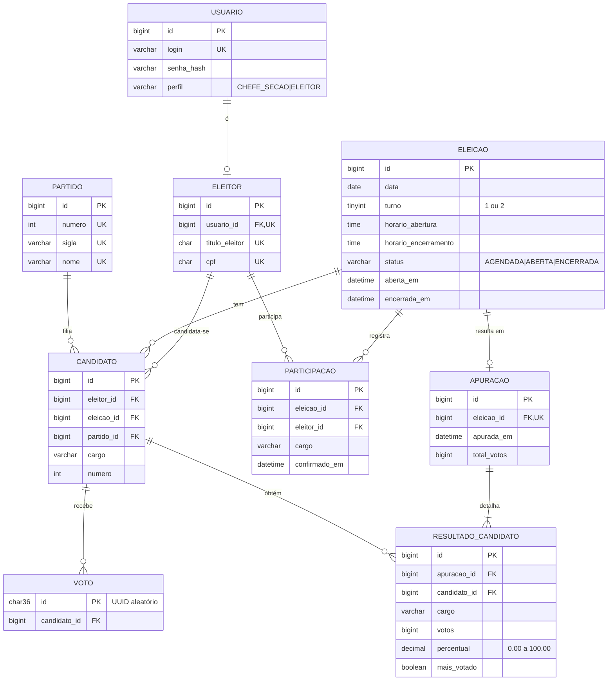

# Modelagem do banco de dados

SGBD: MySQL 8.0.16 ou superior (necessário para as restrições `CHECK`); os testes de integração usam MySQL 8.4.
Schema versionado com Flyway (`src/main/resources/db/migration`): V1 schema, V2 dados iniciais (Chefe da Seção),
V3 partidos (30 partidos registrados no TSE), V4 apuração (resultado final).

## Diagrama

## Restrições importantes

| Regra de negócio | Como o banco garante |
|---|---|
| Um eleitor vota uma única vez por cargo, por eleição/turno | `UNIQUE (eleicao_id, eleitor_id, cargo)` em `participacao` |
| Não existem duas eleições no mesmo dia e turno | `UNIQUE (data, turno)` em `eleicao` |
| Turno só pode ser 1 ou 2 | `CHECK (turno IN (1, 2))` |
| Encerramento depois da abertura | `CHECK (horario_abertura < horario_encerramento)` |
| Status válido | `CHECK (status IN ('AGENDADA','ABERTA','ENCERRADA'))` |
| Número eleitoral único por cargo na eleição | `UNIQUE (eleicao_id, cargo, numero)` em `candidato` |
| Uma pessoa concorre a um único cargo por eleição | `UNIQUE (eleitor_id, eleicao_id)` em `candidato` |
| Só quem é eleitor pode ser candidato | `FK candidato.eleitor_id -> eleitor.id` |
| Cargos válidos | `CHECK` em `candidato.cargo` e `participacao.cargo` |
| Login único | `UNIQUE (login)` em `usuario` |
| Número, sigla e nome do partido únicos | `UNIQUE` em `partido` |
| CPF e título de eleitor únicos | `UNIQUE` em `eleitor` |
| Número do candidato entre 1 e 99999 | `CHECK` em `candidato.numero` |
| Uma eleição tem um único resultado final | `UNIQUE (eleicao_id)` em `apuracao` |
| Um candidato aparece uma vez no resultado final | `UNIQUE (apuracao_id, candidato_id)` em `resultado_candidato` |
| Votos e percentual válidos no resultado | `CHECK (votos >= 0)` e `CHECK (percentual BETWEEN 0 AND 100)` |

## O candidato também é eleitor

Não existe perfil `CANDIDATO`. O candidato é um **eleitor** (tem `usuario` com perfil
`ELEITOR` e uma linha em `eleitor`) que possui uma linha em `candidato` para a eleição.

- Ele **vota em todos os cargos**, como qualquer eleitor, inclusive em si mesmo.
- No **acompanhamento da votação**, se ele tem candidatura na eleição, vê apenas o cargo
  dela; caso contrário, vê todos os cargos. Essa regra fica na camada de serviço
  (apuração), consultando `CandidatoApi#buscarPorEleitorEEleicao`.
- Como a candidatura é por eleição (e cada turno é uma eleição), o candidato precisa
  ser cadastrado em cada turno em que concorre.

## Partidos

Os 30 partidos registrados no TSE entram pela migration V3, com o **número da legenda** (`partido.numero`).
Não há CRUD de partido: a API só consulta (`GET /partidos`). Regra de negócio (no serviço de candidatos): o
**número do candidato começa com o número do partido** (partido 13 → candidatos 13, 131, 13456...).

## Sigilo do voto (decisão central)

Dois registros separados, gravados na **mesma transação**:

- `participacao` responde "o eleitor X já votou para Governador?" (impede duplicidade) e **não sabe em quem**.
- `voto` responde "quantos votos o candidato Y teve?" e **não sabe quem votou**.

Cuidados para que não seja possível reconstruir a ligação por vias indiretas:
- `voto` **não tem `eleitor_id`**.
- `voto` **não tem data/hora** (senão cruzaria com `participacao.confirmado_em`).
- `voto.id` é **UUID aleatório** (um auto-incremento permitiria cruzar a ordem com `participacao.id`).

Eleição e cargo do voto são obtidos via `candidato` (sem redundância).

## Por que o status tem `aberta_em` / `encerrada_em`

`horario_abertura` e `horario_encerramento` são o **agendamento**. As colunas `aberta_em` e `encerrada_em` guardam quando o Chefe da Seção **de fato** abriu/encerrou.

## Apuração: parcial calculada, final gravada

- A **apuração parcial** (eleição `ABERTA`) não é gravada: a cada consulta ela é calculada a partir da tabela `voto`
  (via `ContagemVotosApi`, do módulo votação), então reflete os votos em tempo real.
- O **resultado final** é gravado **uma única vez**, no encerramento da votação: uma linha em `apuracao` e uma linha
  em `resultado_candidato` por candidato, com votos, percentual e a marca `mais_votado`. Mais de um `mais_votado`
  no mesmo cargo indica **empate**. A partir daí a consulta do resultado lê essas tabelas (registro oficial congelado).
- `resultado_candidato` não guarda nada sobre eleitores: o sigilo do voto continua preservado.
